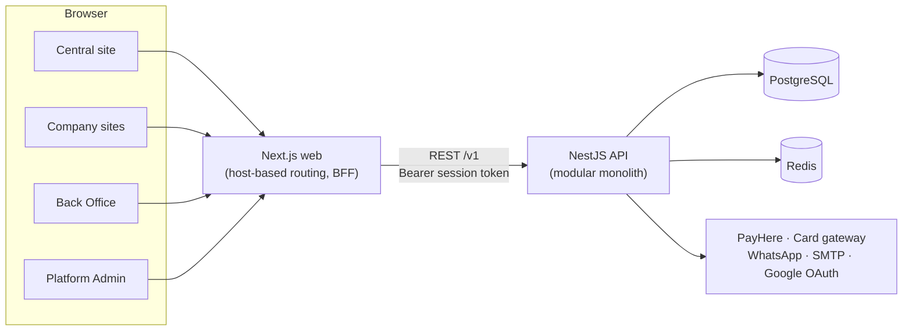

# Sanchara

A multi-tenant hospitality platform for Sri Lankan accommodation providers. Each company gets its own booking website and back office, while travellers discover properties through one central directory.

> **Status:** active development (Level 2 Software Project, University of Moratuwa). Guest authentication is implemented end to end. The Traveller, Back Office and Platform Admin interfaces are being built, and most backend business modules are still scaffolds.

## Overview

Sanchara serves four audiences from a single REST API:

| Application | Who uses it | What it does |
|---|---|---|
| **Central site** | Travellers | Property directory with search and filters, property pages, guest sign-in, Traveller Dashboard |
| **Company sites** | Travellers | A website for each company on `{company}.<platform-domain>` or a custom domain, with its own Booking Engine |
| **Back Office** | Owners, Managers, Front Desk | Inventory, rates, reservations, staff, reports, website builder and subscription billing, with role-based access |
| **Platform Admin** | Sanchara team | Company onboarding, account enforcement, financial operations, platform configuration, announcements and audit logs |

### Key capabilities

- **Multi-tenancy:** a shared database with a `company_id` on every tenant table, and tenants resolved by host.
- **Dual currency:** residents pay in LKR through PayHere and non-residents pay in USD through an international card gateway.
- **Configuration-driven pricing and tax:** prices and taxes (Service Charge, TDL, SSCL, VAT) are calculated by effective date, and every reservation stores a snapshot of its quotation.
- **No double booking:** availability is enforced in the database. Holds are rows that expire.
- **Role-aware Back Office:** what each person can do is computed from the company's active staff and checked on every write.
- **Subscription enforcement:** a company is suspended for non-payment and reactivated automatically when it pays.
- **Messaging:** email (SMTP) and the WhatsApp Business API.

## Tech stack

| Layer | Technology |
|---|---|
| Frontend | Next.js 16 (App Router), React 19, TypeScript, Tailwind CSS v4, shadcn/ui, Radix UI, Zod |
| Backend | NestJS 12, TypeScript, Prisma 7 (pg adapter), class-validator, Argon2 |
| Data | PostgreSQL 17, Redis 8 (sessions, rate limits, cache) |
| Testing | Vitest and Supertest (API), Playwright (web end-to-end) |
| Tooling | Docker Compose, Make, oxlint, ESLint, Prettier |

## Architecture



- **Frontend:** a single Next.js app. `src/proxy.ts` rewrites each host to an internal segment (`central`, `site/[host]`, `backoffice`, `admin`). It follows the backend-for-frontend (BFF) pattern: the browser never holds API tokens, and sessions live in httpOnly `__Host-` cookies, one per audience.
- **Backend:** a modular monolith with one NestJS module per business area (identity, tenancy, inventory, booking core, money, engagement, operations). Modules communicate only through exported services or domain events.

See [`docs/backend-architecture.md`](docs/backend-architecture.md) and [`docs/frontend-architecture.md`](docs/frontend-architecture.md) for full details.

## Repository structure

```
sanchara/
├── backend/                 NestJS API
│   ├── prisma/              Schema and migrations
│   ├── src/
│   │   ├── common/          Config, errors, filters, middleware, Prisma, Redis
│   │   ├── modules/         One folder per business area
│   │   └── health/          Database and Redis health check
│   └── test/                End-to-end API tests
├── frontend/                Next.js web app
│   ├── src/
│   │   ├── app/             Routes: central, site/[host], backoffice, admin
│   │   ├── features/        Domain features
│   │   ├── components/      UI primitives and shells
│   │   └── lib/             API client, auth, tenant, formatting
│   └── e2e/                 Playwright tests
├── docs/                    Architecture documentation
├── docker-compose.yml       Development environment
├── Makefile                 Development commands
└── .env.example             Environment template
```

## Getting started

### Prerequisites

- [Docker](https://docs.docker.com/get-docker/) with Docker Compose v2
- GNU Make
- Node.js `22.23.3` (see [`.nvmrc`](.nvmrc)), needed only for running tools outside Docker

### Setup

```sh
git clone https://github.com/vertex-uom/sanchara.git
cd sanchara
cp .env.example .env     # adjust ports and credentials if needed
make build
make up                  # the API applies pending migrations on start
```

| Service | URL |
|---|---|
| Web (central site) | http://localhost:3001 |
| Back Office | http://backoffice.localhost:3001 |
| Platform Admin | http://admin.localhost:3001 |
| API | http://localhost:3000/v1 |
| Health check | http://localhost:3000/health |
| PostgreSQL | `localhost:5434` |
| Redis | `localhost:6379` |
| Node debugger | `localhost:9229` |

`*.localhost` resolves to `127.0.0.1`, so local development needs no DNS setup. All ports are bound to `127.0.0.1` and can be changed in `.env`.

## Development

| Command | Description |
|---|---|
| `make up` / `make down` | Start or stop all services (the database volume is kept) |
| `make logs [s=api]` | Follow logs |
| `make ps` | Service status and health |
| `make migrate [name=...]` | Create a migration after a schema change |
| `make seed` | Seed the database |
| `make psql` / `make redis-cli` | Open a database or Redis shell |
| `make shell-api` / `make shell-web` | Open a shell in an app container |
| `make add-api pkg=...` / `make add-web pkg=...` | Install a package |
| `make rebuild-api` / `make rebuild-web` | Rebuild an image and refresh `node_modules` |
| `make reset-db` | Drop all data and re-apply migrations (asks for confirmation) |

Run `make help` for the full list. [`DOCKER_DEV.md`](DOCKER_DEV.md) covers troubleshooting.

### Testing

```sh
docker compose exec api npm test           # API unit tests
docker compose exec api npm run test:e2e   # API end-to-end tests
docker compose run --rm e2e                # Web end-to-end tests (Playwright)
```

### Linting and type checks

```sh
docker compose exec api npm run lint
docker compose exec web npm run lint
docker compose exec web npm run typecheck
```

## Configuration

All configuration lives in `.env` (copied from [`.env.example`](.env.example)). The main groups are:

- **Ports:** `API_PORT`, `WEB_PORT`, `POSTGRES_HOST_PORT`, `REDIS_HOST_PORT`
- **Database:** `POSTGRES_USER`, `POSTGRES_PASSWORD`, `POSTGRES_DB`
- **URLs and tenancy:** `NEXT_PUBLIC_API_URL`, `API_INTERNAL_URL`, `WEB_APP_URL`, `PLATFORM_DOMAIN`
- **Auth:** `GOOGLE_CLIENT_ID`, `GOOGLE_CLIENT_SECRET`, `GOOGLE_CALLBACK_URL`
- **Payments:** `PAYHERE_*` (LKR) and `CARD_GATEWAY_*` (USD)
- **Messaging:** `WHATSAPP_*`, `SMTP_*`

> Never commit `.env` or real credentials. Use sandbox or test accounts for every external service.

## Contributing

1. Branch from `dev` (`feat/...`, `fix/...`).
2. Write commits in the [Conventional Commits](https://www.conventionalcommits.org/) style, for example `feat(admin): build Audit Logs tab`.
3. Open a pull request into `dev`. `main` holds release-ready code.

## Team

Built by **Vertex** at the University of Moratuwa.

## License

Proprietary. All rights reserved.
