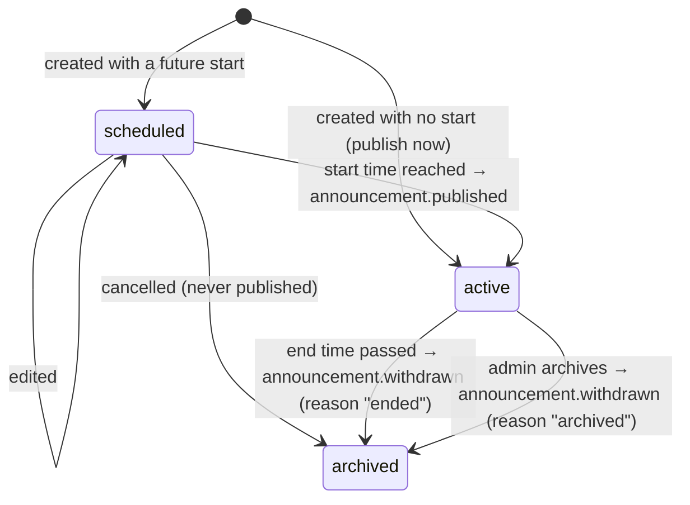

# Announcements: API and event contract

Announcements are messages from the platform team (Platform Admin console) to company
staff: new features, maintenance windows, policy changes, reminders and urgent notices.

**Delivery rule: announcements reach staff only as system notifications in the Back
Office. Never by email or WhatsApp.** The `announcements` module stores them and raises
domain events; the `notifications` module turns those events into system notifications.

Follows [backend-architecture.md](backend-architecture.md): REST under `/v1`, one error
shape `{ status, code, message, fieldErrors }`, modules talk through exported services and
in-process domain events.

## Who owns what

| Part | Owner | Where |
|---|---|---|
| Admin API (create, edit, archive, list) | `announcements` + `platform-admin` | `backend/src/modules/announcements`, `backend/src/modules/platform-admin/announcements.controller.ts` |
| `announcements` table, status, publish/withdraw timing | `announcements` | same |
| Events `announcement.published` / `announcement.withdrawn` | `announcements` raises them | `backend/src/modules/announcements/announcement.events.ts` |
| Event dispatcher | shared | `backend/src/common/events/domain-events.ts` |
| Recipients, notification storage, read/dismiss state, staff-facing API, Back Office bell | `notifications` | `backend/src/modules/notifications`, [notifications-api-contract.md](notifications-api-contract.md) |

## Lifecycle



- **Status is derived from the times, never stored:** `scheduled` while `starts_at` is in
  the future; `active` from `starts_at` until `ends_at`; `archived` after `ends_at` or once
  `archived_at` is set.
- **Scheduled** announcements can be edited or cancelled.
- **Once started** an announcement can't be edited (409 `ANNOUNCEMENT_LIVE`); the admin
  archives it and creates a new one. Archived announcements are read-only.
- **Audience:** staff of **active and suspended** companies (`ACTIVE`,
  `SUSPENDED_NON_PAYMENT`, `SUSPENDED_BY_ADMIN`) with the audience's roles and an
  `ACTIVE` staff account. Companies still in `PENDING_SETUP` are left out.

## Publishing

A publisher inside the `announcements` module runs **every minute**, once at start-up,
and right after an admin publishes "now", edits a schedule into the past, or archives.
Each pass:

1. **Publish** every announcement that has started, has not ended, is not archived and
   has no `published_at`: claim it (`published_at = now`, conditional update), then raise
   `announcement.published`.
2. **Withdraw** every published announcement that ended or was archived and has no
   `withdrawn_at`: claim it (`withdrawn_at = now`), then raise `announcement.withdrawn`.

Guarantees:

- **Once per announcement, even with several API instances.** The claim is a conditional
  update; only the instance that wins raises the event.
- **At least once.** If a listener throws, the claim is undone and the next pass (within
  a minute) raises the event again. **Listeners must be idempotent, keyed by
  `announcementId`.**
- **Within one minute** of the start or end time (immediately for "publish now" and
  archive).
- An announcement that starts and ends while the API is down is never published.
- Cancelling a scheduled announcement raises nothing (it was never published).

## Domain events

Raised in-process with `DomainEvents` (`src/common/events/domain-events.ts`). Listeners
run one after another and are awaited.

```ts
// backend/src/modules/announcements/announcement.events.ts
type AnnouncementPublished = {
  announcementId: string;          // UUID; the idempotency key
  title: string;                   // plain text, ≤ 80 chars: render as text, never HTML
  message: string;                 // plain text, ≤ 400 chars
  type: 'feature' | 'maintenance' | 'policy' | 'reminder' | 'urgent';
  audience: 'all-staff' | 'owners' | 'managers' | 'front-desk';
  recipients: {
    roles: ('OWNER' | 'MANAGER' | 'FRONT_DESK')[];
    staffStatuses: ['ACTIVE'];
    companyStatuses: ['ACTIVE', 'SUSPENDED_NON_PAYMENT', 'SUSPENDED_BY_ADMIN'];
  };
  dismissible: boolean;            // staff may close it
  startsAt: string;                // ISO 8601 (UTC)
  endsAt: string | null;           // null = until archived
  publishedAt: string;             // ISO 8601 (UTC)
};

type AnnouncementWithdrawn = {
  announcementId: string;
  reason: 'archived' | 'ended';
  withdrawnAt: string;             // ISO 8601 (UTC)
};
```

Subscribing (in the notifications module):

```ts
@Injectable()
export class AnnouncementNotifications implements OnModuleInit {
  constructor(private readonly events: DomainEvents) {}

  onModuleInit() {
    this.events.on('announcement.published', (event) => this.show(event));   // must be idempotent
    this.events.on('announcement.withdrawn', (event) => this.remove(event)); // must be idempotent
  }
}
```

Rebuilding state (e.g. after a restart or a missed event):
`AnnouncementsService.liveAnnouncements()` (exported by `AnnouncementsModule`) returns every
published, not-yet-withdrawn announcement as `AnnouncementPublished[]`.

### Recipients

`audience` → roles: `all-staff` = OWNER, MANAGER, FRONT_DESK; `owners` = OWNER;
`managers` = MANAGER; `front-desk` = FRONT_DESK. The event carries the resolved lists in
`recipients`, so the notifications module needn't know the mapping. Equivalent SQL:

```sql
SELECT s.id
FROM staff s
JOIN companies c ON c.id = s.company_id
WHERE s.role   = ANY($roles::staff_role[])
  AND s.status = 'ACTIVE'
  AND c.status IN ('ACTIVE', 'SUSPENDED_NON_PAYMENT', 'SUSPENDED_BY_ADMIN');
```

## Admin HTTP API

All routes need an admin session (`Authorization: Bearer <admin token>`; 401 otherwise).

| Method and path | Purpose |
|---|---|
| `GET /v1/admin/announcements?status=active\|scheduled\|archived&page=1` | One status, 8 per page. Active: newest start first. Scheduled: soonest first. Archived: most recently ended or archived first. |
| `GET /v1/admin/announcements/summary` | `{ active, scheduled, archived }` counts |
| `GET /v1/admin/announcements/{id}` | One announcement (404 if unknown) |
| `POST /v1/admin/announcements` | Create. No `startsAt` = publish now. 201. |
| `PUT /v1/admin/announcements/{id}` | Replace a **scheduled** announcement (same body). 409 once started or archived. |
| `POST /v1/admin/announcements/{id}/archive` | Cancel a scheduled one or take a live one down. 200; archiving again changes nothing. |

Request body (create and replace):

```json
{
  "title": "Maintenance: database upgrade, 2 Nov 01:00–03:00",
  "message": "Back Office is read-only on 2 Nov between 01:00 and 03:00 (GMT+5:30).",
  "type": "maintenance",
  "audience": "all-staff",
  "dismissible": false,
  "startsAt": "2026-11-01T09:00:00+05:30",
  "endsAt": "2026-11-02T03:00:00+05:30"
}
```

- `title` 1–80, `message` 1–400 characters (trimmed); plain text.
- `startsAt` / `endsAt`: ISO 8601 **with an offset** (`+05:30` or `Z`). `startsAt`
  optional (now); up to 5 minutes in the past counts as now, further back is rejected; at
  most a year ahead. `endsAt` optional or `null` (until archived); must be after the start.
- Unknown fields are rejected (there is no `channels` field: delivery is always a system
  notification).

Response (every endpoint returning an announcement):

```json
{
  "id": "01a185dd-c18d-732c-ab57-f10a14ed7a4d",
  "title": "…", "message": "…",
  "type": "maintenance", "audience": "all-staff", "dismissible": false,
  "status": "scheduled",
  "startsAt": "2026-11-01T03:30:00.000Z", "endsAt": "2026-11-01T21:30:00.000Z",
  "createdBy": { "id": "…", "fullName": "Ruwan Perera" },
  "createdAt": "…",
  "archivedAt": null, "archivedBy": null,
  "publishedAt": null, "withdrawnAt": null
}
```

Errors: 400 `VALIDATION_FAILED` (with `fieldErrors` per field), 404 `NOT_FOUND`,
409 `ANNOUNCEMENT_LIVE`, 409 `ANNOUNCEMENT_ARCHIVED`.

Audit entries (`audit_entries`, entity type `announcement`): `announcement.created`,
`announcement.updated`, `announcement.cancelled`, `announcement.archived` (actor: the
admin); `announcement.published`, `announcement.withdrawn` (actor: SYSTEM).

## Database

Migration `backend/prisma/migrations/20261029090000_announcements`.

```sql
CREATE TYPE announcement_type     AS ENUM ('FEATURE', 'MAINTENANCE', 'POLICY', 'REMINDER', 'URGENT');
CREATE TYPE announcement_audience AS ENUM ('ALL_STAFF', 'OWNERS', 'MANAGERS', 'FRONT_DESK');

CREATE TABLE announcements (
  id             uuid PRIMARY KEY,                 -- UUIDv7
  title          varchar(80)  NOT NULL,            -- CHECK 1..80 after trim
  message        varchar(400) NOT NULL,            -- CHECK 1..400 after trim
  type           announcement_type     NOT NULL,
  audience       announcement_audience NOT NULL,
  dismissible    boolean      NOT NULL DEFAULT true,
  starts_at      timestamptz(3) NOT NULL,
  ends_at        timestamptz(3),                   -- CHECK ends_at > starts_at; null = until archived
  created_by_id  uuid REFERENCES platform_admins(id) ON DELETE SET NULL,
  created_at     timestamptz(3) NOT NULL DEFAULT now(),
  updated_at     timestamptz(3) NOT NULL,
  archived_at    timestamptz(3),
  archived_by_id uuid REFERENCES platform_admins(id) ON DELETE SET NULL,
  published_at   timestamptz(3),                   -- when announcement.published was raised
  withdrawn_at   timestamptz(3)                    -- when announcement.withdrawn was raised; CHECK only after published_at
);
CREATE INDEX announcements_starts_at_idx  ON announcements (starts_at);
CREATE INDEX announcements_to_publish_idx ON announcements (starts_at) WHERE published_at IS NULL AND archived_at IS NULL;
CREATE INDEX announcements_live_idx       ON announcements (ends_at)   WHERE published_at IS NOT NULL AND withdrawn_at IS NULL;
```

The notifications module must not read or write this table directly (module rule); it
uses the events and `AnnouncementsService.liveAnnouncements()`.
