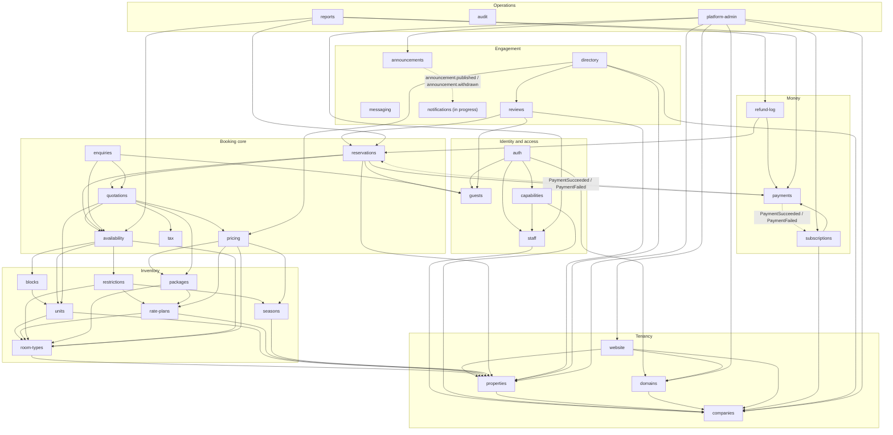

# Backend architecture

A modular monolith: one NestJS app (`backend/`), one PostgreSQL database (Prisma),
Redis for sessions and cached availability. One REST API serves the central site,
company sites, Back Office and Platform Admin.

## Module rules

- Each business area is a module in `src/modules/<name>` (flat; areas are listed below).
- Modules talk only through **exported services** or **in-process domain events**, never
  through another module's tables.
- Inside a module: controller → service → repository. Controllers hold no business logic.
  DTOs for all input and output.
- Shared, non-business code lives in `src/common` (see below).
- Any module may call `audit`. Cycles are broken with events, not mutual imports.
- No scheduler or background job module (mechanism is open). Exception: `announcements` runs
  its own one-minute timer to publish and withdraw announcements (no extra library).

## Modules and allowed dependencies

Arrows mean "may call the exported service of". Dashed arrows are domain events.

- `payments`, `tax`, `guests`, `companies`, `messaging`, `announcements` and `audit` depend on no
  module (any module may call `audit`).
- `platform-admin` must never depend on `guests`, `reservations`, `enquiries`, `payments`
  or `refund-log` (admins must not read bookings or guests).
- **Proposed, confirm:** `availability` owns unit/date allocations (bookings and holds).
  Reservations and enquiries ask it to hold or allocate. This keeps the dependency one-way
  and puts the double-booking constraint on one table.

## Module responsibilities

| Area | Module | Responsibility | Owns |
|---|---|---|---|
| Identity and access | `auth` | Sign-in for guests (email+password or Google), staff (email+password or Google) and platform admins (email+password or Google for existing admins, + two-step; two-step not built yet). Opaque sessions in Redis per audience; single-use, host-bound handoff codes. Admins are created with `make admin`. | sessions and handoff codes (Redis), platform admins and their credentials |
| Identity and access | `capabilities` | Computes a user's capabilities from the company's active staff set; used by /me and enforced on every write. | none (derived) |
| Identity and access | `guests` | Guest accounts and profiles (resident/non-resident, optional WhatsApp), walk-in/phone guest records. | guests |
| Identity and access | `staff` | Staff accounts per company (Owner, Manager, Front Desk), invites, activation. | staff accounts, invites |
| Tenancy | `companies` | Companies (tenants), one subdomain each, and the company status state machine (pending setup → active when the Owner accepts the invite; suspended for non-payment, suspended by administrator). | companies, company status history |
| Tenancy | `domains` | Company subdomains and custom domains; host-to-company resolution. | domains |
| Tenancy | `properties` | Properties owned by a company, and the reference data they use. | properties, property types, provinces and districts |
| Tenancy | `website` | Company website content (website builder). | website pages and settings |
| Inventory | `blocks` | Date blocks on units (Owner/Manager). | blocks |
| Inventory | `packages` | Packages combining units/room types and rates. | packages |
| Inventory | `rate-plans` | Rate plans and rate cards (resident LKR, non-resident USD). | rate plans, rate cards |
| Inventory | `restrictions` | Stay restrictions (e.g. minimum stay) by date. | restrictions |
| Inventory | `room-types` | Room types per property. | room types |
| Inventory | `seasons` | Seasons with effective date ranges. | seasons |
| Inventory | `units` | Named, bookable units of a room type. | units |
| Booking core | `availability` | Answers availability from units, blocks, restrictions and allocations. Proposed: owns unit/date allocations (bookings and holds with expiry) and the future exclusion constraint. Expired holds are ignored. Results may be cached in Redis. | unit allocations and holds (proposed) |
| Booking core | `enquiries` | Enquiry holds (rows with expiry) for phone/walk-in enquiries. | enquiries |
| Booking core | `pricing` | Pure, configuration-driven price calculation by effective date. Nothing hard-coded. | none (reads configuration through exported services) |
| Booking core | `quotations` | Itemised price and tax breakdown for a stay; the result is snapshotted on the reservation. | quotations |
| Booking core | `reservations` | Reservations, folios, check-in/out. Stores the quotation snapshot and an immutable exchange rate. Starts payment; reacts to payment events. | reservations, folios |
| Booking core | `tax` | Pure tax calculation (Service Charge, TDL, SSCL, VAT) from configuration by effective date. Formulas, order, bases and rates are open. | tax configuration |
| Money | `payments` | Gateway-neutral payments. Gateway chosen by currency (PayHere for LKR, international card for USD). Idempotent webhooks. Emits payment events; never calls reservations or subscriptions. | payments, gateway events (idempotency keys) |
| Money | `refund-log` | Manual refund log. | refund entries |
| Money | `subscriptions` | Company subscription and plan. Payment lifts a non-payment suspension. One current subscription per company. | subscriptions, plans |
| Engagement | `directory` | Central directory search (location, price range, rating, property type, featured placement). Hides suspended companies. | none (read model may come later) |
| Engagement | `announcements` | Platform announcements to company staff (feature, maintenance, policy, reminder, urgent; audience by role). Raises `announcement.published` when one starts and `announcement.withdrawn` when it ends or is archived; never sends email or WhatsApp. Contract: [announcements-api-contract.md](announcements-api-contract.md). | announcements |
| Engagement | `messaging` | Email and WhatsApp Business messages. Called by other modules or reacts to events. | message log |
| Engagement | `notifications` | System (in-app) notifications for staff; turns announcement events into notifications. In progress (separate work). | notifications (planned) |
| Engagement | `reviews` | Guest reviews and ratings. | reviews |
| Operations | `audit` | One audit service: who changed what and when for rates, reservations, payments, refunds, blocks and staff accounts. Kept 1 year. Owner-only view. | audit entries |
| Operations | `platform-admin` | Open (onboarding: company + first property + plan + invited Owner, in one transaction), suspend and reactivate companies; platform exchange rate; build a company website on request. Must not read bookings or guests. | none |
| Operations | `reports` | Reports. The list per plan is open. | none |

## Shared code (`src/common`, created when first code lands)

| Folder | Purpose |
|---|---|
| `guards` | Audience guards (guest, staff, admin) and the capability guard on every write |
| `filters` | Global exception filter producing `{ status, code, message, fieldErrors }` |
| `interceptors` | Cross-cutting concerns (request logging, mapping responses to DTOs) |
| `decorators` | Current user, required capability |
| `tenant-context` | Per-request company id; repositories always filter by it |
| `config` | Typed environment access (today: `process.env` directly) |

## Principles (documented, not implemented yet)

1. **Multi-tenancy.** Shared database; `company_id` on every tenant table. A tenant
   context is set per request (from the session or the request host) and repositories
   always filter by it. Row-level security: open.
2. **No double booking, enforced in the database.** A future migration adds an exclusion
   constraint on (unit, date range) for active allocations, not only a code check.
3. **Holds are rows with an expiry**: 10-minute pending-payment holds and enquiry holds.
   Availability ignores expired holds. How expired rows are cleaned up is deferred.
4. **Pricing and tax are pure** and configuration-driven by effective date; nothing is
   hard-coded. The quotation result is snapshotted on the reservation. A reservation's
   exchange rate is immutable.
5. **Payment** sits behind a gateway-neutral interface (`payments/gateway`); adapters in
   `payments/adapters/{payhere,international-card}`. Gateway chosen by reservation
   currency (LKR → PayHere, USD → international card). Webhooks are idempotent (gateway
   event id stored once).
6. **Capabilities.** `/me` returns capabilities computed from the company's active staff
   set; every write is checked against them. Front-desk data hidden from Owner and Manager
   is read-only for them (the Owner's hiding is a UI choice; the Manager's read-only is enforced).
7. **Audit.** One service records who changed what and when for rates, reservations,
   payments, refunds, blocks and staff accounts. Retained 1 year. Owner-only view.
8. **Suspension.** Company status state machine: active ↔ suspended (non-payment) and
   active ↔ suspended (administrator). Non-payment suspension lifts automatically on
   payment; administrator suspension only manually.
9. **Sessions.** Opaque session ids in Redis, separate for guest, staff and admin.
   Token: 32 random bytes (base64url), sent by the Next server as `Authorization: Bearer`;
   Redis stores only its SHA-256. Guests: 24h idle (30 days with "Remember me"), 90-day cap.
   Handoff one-time codes in Redis: single-use, short-lived, bound to the target host.
10. **API contract.** REST under `/v1`; OpenAPI generated from the code; one error shape
    `{ status, code, message, fieldErrors }`.

## Current state vs. principles

| Item | Today |
|---|---|
| `/v1` prefix | Applied to all REST routes; `/health` stays at the root. |
| `/health` | Database + Redis check; used by the api Docker healthcheck. |
| OpenAPI | No Swagger setup; needs `@nestjs/swagger` (not installed). |
| DTO validation | `class-validator` + `class-transformer` through a global `ValidationPipe` (unknown fields rejected). |
| Redis sessions/cache | `ioredis`; guest, staff and admin sessions, rate limits, reset/invite tokens and OAuth state live in Redis (`src/common/security`). |
| Domain events | Small in-process dispatcher, `DomainEvents` in `src/common/events` (no library). The raising module declares its events by extending `DomainEventMap`; listeners are awaited and must be idempotent. |
| Config | `@nestjs/config` with startup validation; inject the typed `AppConfig`. |
| Prisma | 7.x with `PrismaService` (pg adapter); client generated into `src/generated/prisma`. Migrations apply on api start. Models: guests, staff, platform admins (with credentials); companies with status history; properties; subscriptions; announcements; audit entries; reference data (provinces, districts, property types, plans; seeded by migrations, plan prices are placeholders). Cross-module writes share a transaction by passing a `Db` (`src/common/prisma/db.ts`). |

Each library above needs approval before it is added.

## Open items (not decided)

- Tax formulas, order of application, bases and rates.
- Plan prices and limits (and which reports each plan includes).
- USD card gateway provider.
- Check-in identity data.
- Who updates the platform exchange rate, how often, and which module stores it.
- What happens to a payment in progress when a company is suspended.
- Background job mechanism (hold cleanup, retries, messaging).
- Row-level security.
- Role scope: per company (current frontend assumption, a company owning several
  properties) or one property per company.
- Handoff-code contract with the frontend.
- Ownership of allocations (`availability`, proposed above).
