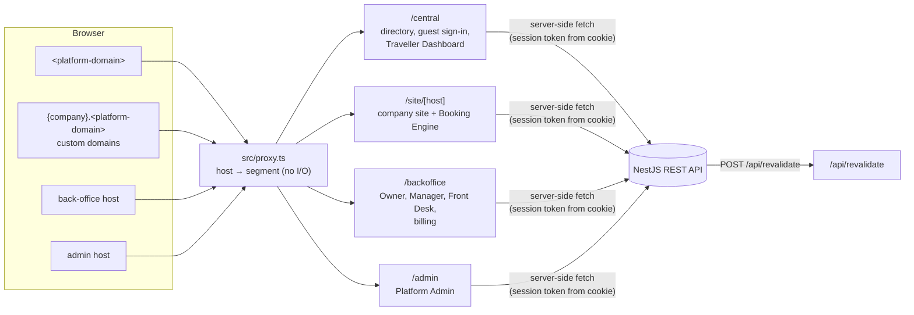
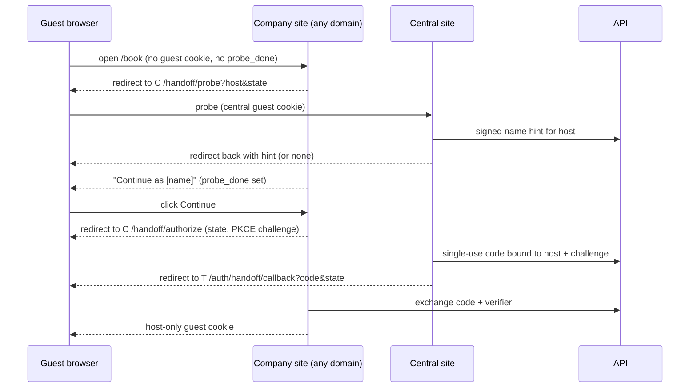

# Frontend architecture

One Next.js 16 app (`frontend/`, App Router, `src/`) serves five client areas from one
REST API. Server Components by default; client components only for interactivity.
Pricing, tax, availability and permissions are decided by the API; the frontend renders
what it returns.

## Hosts and routing

Route groups cannot serve the same URL twice, so `src/proxy.ts` rewrites each host to an
internal segment that has its own root layout. A request that already carries a prefix is
prefixed twice and 404s, so internal paths are not reachable directly.

| Env var | Dev default |
|---|---|
| `PLATFORM_DOMAIN` | `sanchara.localhost` (plain `localhost` also maps to central in dev) |
| `BACKOFFICE_HOST` | `backoffice.localhost` |
| `ADMIN_HOST` | `admin.localhost` |

Any other host goes to `/site/[host]`; the site layout asks the API which tenant owns it.
`*.localhost` resolves to 127.0.0.1, so dev needs no DNS (port 3001 in Docker).
These env vars are not yet passed to the web container; that is a Docker follow-up.

## Applications

| Segment | Purpose | Notes |
|---|---|---|
| `central` | Directory (`/properties?location&minPrice&maxPrice&minRating&type`), property pages, Google-only guest sign-in, Traveller Dashboard | No booking or payment. Suspended companies are filtered out by the API. |
| `site/[host]` | Tenant site (website-builder pages) and Booking Engine (`/book`) | Booking Engine lives only here (no embedding on external sites). Suspended: site online, `/book` shows a notice. |
| `backoffice` | Configuration, operations, staff, reports, subscription, website builder | Property in the URL: `/p/[propertyId]/…`. Suspended company: Owner reaches only `/billing`; other staff see `/suspended`. |
| `admin` | Companies, exchange rate, build website on request | Lint rule forbids importing booking or guest features. |

## Back Office roles

Staff are per company. What a user sees depends on which roles exist in the company.

| Part | Contents |
|---|---|
| Owner-only | Subscription/plan, audit trail |
| Management | Configuration, availability and date blocks, packages, staff, reports, website builder, reviews (read-only), properties |
| Front-desk | Calendar, reservations and folios, guest records, enquiry holds, payments and refund log, check-in/out |

| Company has | Owner | Manager | Front Desk |
|---|---|---|---|
| Owner only | All parts | – | – |
| Owner + Manager | Owner-only, Management. Front-desk hidden | Management, Front-desk (full) | – |
| Front Desk staff (with or without Manager) | Owner-only, Management. Front-desk hidden | Management, Front-desk read-only | Front-desk |

- Hiding from the Owner is **UI only**; the API still permits it. The Manager's read-only
  front-desk access **is** enforced by the API.
- Owner manages Manager and Front Desk; Manager manages Front Desk. Removing staff
  restores their parts to whoever had them before.
- `/me` returns role + company staffing; `lib/auth/permissions.ts` derives menus and route
  visibility from it. No role rule is enforced only in the frontend.

## Auth and sessions

- **BFF:** the browser never holds API tokens. Next stores an API-issued token in a
  host-only, httpOnly, `__Host-`, SameSite=Lax cookie per audience (guest, staff, admin).
  Host-only cookies keep audiences and tenant subdomains apart.
- **Guests:** Google only (authorization code → API). **Staff:** email+password or Google.
  **Admin:** email+password or Google (existing admins only, linked by verified email), then mandatory two-step verification; short idle timeout.
- **Guards:** `proxy.ts` may do optimistic cookie-presence redirects; DAL helpers
  (`requireGuest/Staff/Admin`) run in pages and every Server Action; the API decides.
  401 → sign-in, 403 → `/forbidden`, suspended → `/billing` or `/suspended`.

### "Continue as [name]" on company sites (redirect probe)

Cookies do not cross domains and third-party cookies are blocked, so the name is fetched
with a top-level redirect, never a hidden frame.

- The probe runs once per visit, only on booking pages, never for bots or SEO pages.
- Only hosts the API has registered for a company are valid return targets (prevents open redirects).
- If browser bounce-tracking protection cleared the central cookie, the guest sees normal Google sign-in.

## Data, caching and states

| Content | Strategy |
|---|---|
| Directory, property pages, reviews, tenant public pages | `'use cache'` + `cacheTag`; API calls `/api/revalidate` on change; short `cacheLife` as backstop. Filters live in the URL and are read behind `<Suspense>`. |
| Availability, quotes, checkout | Per request, never cached. Price and tax lines rendered exactly as returned. |
| Traveller Dashboard, Back Office, Admin | Per request on the server; mutations via Server Actions. Highly interactive screens (calendar) may add a client query cache later. |

- Session reads sit inside `<Suspense>` (required with `cacheComponents`).
- Each app has `not-found.tsx` and `error.tsx` (`retry()`); segments add `loading.tsx`
  skeletons; widgets use `catchError`; lists use a shared empty state.
- All API failures map to `ApiError { status, code, message, fieldErrors }`.

## UI, responsive, accessibility

- Tailwind v4 tokens in `globals.css`; shadcn/ui primitives in `components/ui`; tenant
  branding via CSS variables set in the site layout.
- Mobile-first. Back Office: drawer/bottom nav on phones, collapsible sidebar from `md`;
  tables become cards on phones; calendar is agenda/day on phones, grid on larger screens.
- WCAG 2.2 AA: semantic HTML, visible focus, labelled fields, `aria-live` errors,
  44px touch targets, reduced motion, contrast-checked tokens.

## Forms and API types

Types and Zod schemas generated from the NestJS OpenAPI spec; client validates shape only;
Server Actions call the API and map its `fieldErrors` onto fields.
Prerequisite: backend publishes OpenAPI.

## Code layout and lint rules

`src/app` (routes only) · `src/features/<domain>` · `src/components/{ui,shell}` ·
`src/lib/{api-client,auth,tenant,format}` · `e2e/`. Folders are created when their first
code lands; today only `components/shell` and `lib/tenant` exist. ESLint `no-restricted-imports`:
no imports from `@/app`, no deep imports into another feature, and Admin cannot import
booking/guest features.

## Configuration-driven (undecided, do not hard-code)

Plan limits and reports per plan, tax formulas and rates, USD gateway provider, check-in
identity fields, platform exchange-rate ownership. The UI renders these from API data
(entitlements, tax lines, payment methods, field schemas, rates).

## Open items

- Session token format, name-hint and handoff-code contract: decide with the backend.
- Backend OpenAPI (`@nestjs/swagger`) needed before the API client.
- Libraries proposed but not approved: Orval, TanStack Query, React Hook Form + Zod, nuqs,
  date-fns, Vitest/Testing Library/MSW/Playwright/axe, Prettier.
- Production domains; passing host env vars to the web container.

## Build phases

0. Foundations (this skeleton) · 1. API client and sessions · 2. Directory ·
3. Guest sign-in and Traveller Dashboard · 4. Tenant site and suspended behaviour ·
5. Booking Engine and handoff · 6. Back Office auth, shell, guards, billing ·
7. Back Office modules one at a time · 8. Platform Admin with 2FA.
